# The experiments, explained

A guided tour of what this repository measured, for a reader who does not know the
domain. Thirteen charts, each with one finding, how to read it and why it happens. No prior
knowledge of search systems, model servers or load testing is assumed.

The measurements themselves are in [`experiments/`](../experiments/README.md): every
run, with its settings and its statistics. This folder explains them. Every chart here
is drawn from that registry by a command (`make experiment-charts`), and the table of
numbers behind each chart is in [`data/`](data/).

## In one minute

1. **Reranking is the slow part.** Of the time a request spends in the system, 90 to
   95% is one stage, the reranker.
2. **A reranker serves a fixed number of requests a second.** More users do not get
   more answers, they wait longer: with 16 users on the same machine each waits 15
   seconds instead of 1.
3. **A bigger machine serves about in proportion.** One request costs about 8 seconds
   of one virtual CPU, whatever the machine. Storing the model in 8 bits instead of 32
   brings that to about 5.
4. **More machines or one bigger machine serve about the same once full** (0.87 and
   0.94 requests a second for the same 8 CPUs). Before that the bigger machine answers
   three to four times sooner.
5. **The two model servers compared, OVMS and FastAPI, serve the same amount** once
   they run the same model file. The lead OVMS showed at first was its smaller file.
6. **They differ in who waits.** FastAPI serves requests in arrival order, so everyone
   waits about the same. Under OVMS some requests wait two to three times longer than
   others, and it loses requests sooner when overloaded.
7. **One setting was worth tuning: the batch size** (about a third less time per
   request). OVMS's own setting for parallel requests, its streams, gained 2% at most.
8. **No topology is faster in itself.** What counts is how many CPUs the reranker has
   in total.
9. **A reranker five times larger** is about six times slower, and none of the findings
   above changes.
10. **Writing the answer with a small language model on a CPU takes 8 to 20 seconds**,
    depending on the program that runs it. Reading the question and its passages costs
    about as much as writing the answer.
11. **With several users, the program that computes several answers together serves
    more.** One setting made OVMS go from the worst to the best at 4 users. This last
    part is a first look, on one machine.

## What is being tested

The system answers a question from a set of documents. A question goes through four
stages:

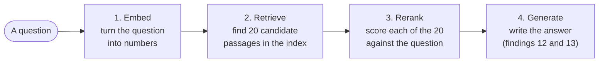

Stages 1 and 3 each run a machine-learning model on the CPU. The model of stage 3, the
**reranker**, reads the question together with each candidate passage and gives the
pair a score. It is the heavy one: 20 passages mean 20 readings. Findings 1 to 11 stop
after stage 3 (the route called `/retrieve`). Findings 12 and 13 are a first look at
stage 4, where a language model writes the answer: there the first three stages were
replaced by stand-ins that cost nothing, so that only the writing was timed.

Three things were varied.

**The topology: where the two models run.**

| Topology | The embedder runs | The reranker runs |
|---|---|---|
| `monolith` | inside the workflow app | inside the workflow app |
| `split-reranker` | inside the workflow app | in its own program, on its own machine |
| `split-all` | in its own program | in its own program |

The workflow app is the program that receives the question and runs the stages.

**The model server: which program runs a model that has its own machine.** Two were
compared. OVMS (OpenVINO Model Server) is a ready-made product. The FastAPI model
server is a small program written for this project. Both run the same model with the
same engine underneath.

**The machine**: 2, 8 or 16 virtual CPUs (vCPUs) for the reranker.

Each combination was then put under load. A load test plays the users: a simulated
user sends a request, waits for the answer, pauses 0.2 to 1 second, and sends the next
one, for 2 minutes. "16 users at
once" means 16 of these in parallel. Such a user asks again within a second of each
answer, which is far more than a person does: 16 of them stand for many more than 16
people.

## How to read the numbers

| Term | Meaning |
|---|---|
| Users at once | How many simulated users send requests in parallel |
| Requests a second | How many requests the system answered each second. This is its throughput: the higher, the better |
| Median wait | Half of the requests were answered faster than this, half slower. The typical wait |
| Slowest 1 in 20 | One request in 20 waited longer than this (the 95th percentile). It shows how unlucky a user can be |
| Failed request | A request not answered within 30 seconds: the limit of the proxy in front of the system |
| vCPU | A virtual CPU. On these machines two vCPUs share one physical core, so 8 vCPUs are 4 cores |
| 32-bit and 8-bit weights | A model is a large table of numbers, its weights. They can be stored with 32 bits each, or rounded to 8 bits: a file four times smaller that computes faster, at a possible small loss of ranking quality (not measured here) |
| Batch size | How many of the 20 passages the reranker scores in one go |
| Stream | One request that OVMS runs at the same time as others. With 2 streams it works on 2 requests at once, each on half of the CPUs |
| Calibration | At start, the program times itself with a few settings and keeps the fastest |
| Token | The unit a language model reads and writes: a word or a piece of a word. 100 tokens are about 75 English words |
| Prompt | Everything the language model is given to read before it answers: here the instructions, the 10 passages kept by the reranker and the question, about 800 tokens |
| Tokens served a second | How many tokens of answers the system wrote each second, for all users together. The throughput of the generate stage |
| 4-bit weights | The same rounding as 8-bit weights, taken further: each weight stored with 4 bits |

Each point of a chart is one run of 2 minutes, a few dozen to 200 requests. A
difference of a few percent between two bars is noise, not a finding. Findings 12 and
13 rest on less: runs of 3 minutes that hold 11 to 30 requests, or single requests.

## What the experiments showed

### 1. Almost all of a request's time is reranking

<picture>
  <source media="(prefers-color-scheme: dark)" srcset="figures/01-where-the-time-goes-dark.svg">
  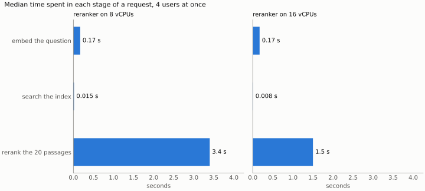
</picture>

**How to read it.** Each bar is the median time a request spends in one stage, with
4 users at once. One panel per size of the reranker's machine.

**What it shows.** Embedding the question takes 0.17 seconds and searching the index
about a hundredth of a second. Reranking takes 3.4 seconds when the reranker has
8 vCPUs and 1.5 seconds when it has 16: 90 to 95% of the total.

**Why it matters.** Any change that does not make reranking faster cannot make the
system noticeably faster. The rest of this page is therefore about the reranker.

Numbers: [`data/01-where-the-time-goes.csv`](data/01-where-the-time-goes.csv).
Sitting: [the reranker scaled up](../experiments/2026-11-15-reranker-scaled-up-8-and-16-vcpus/README.md).

### 2. More users add waiting, not answers

<picture>
  <source media="(prefers-color-scheme: dark)" srcset="figures/02-more-users-more-waiting-dark.svg">
  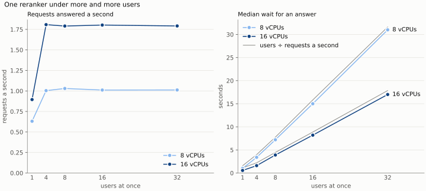
</picture>

**How to read it.** Left: the answers given each second as users are added. Right: how
long each user waits. The grey lines are a prediction, explained below.

**What it shows.** From 4 users on, the reranker on 8 vCPUs answers 1.0 request a
second and no more, however many users ask. The wait grows instead: 3.4 seconds with
4 users, 15 with 16, 31 with 32. On 16 vCPUs the ceiling is 1.8 requests a second and
the waits are about half.

**Why.** The reranker is like a single checkout counter. It serves one customer after
the other at its own pace. More customers do not make it faster: they make the queue
longer.

**A rule that follows.** A user's cycle is the wait plus the short pause before the
next request, so:

> wait ≈ users ÷ requests a second − the pause (about 0.6 seconds here)

For 16 users on 8 vCPUs: 16 ÷ 1.01 − 0.6 = 15.2 seconds. Measured: 15. The grey lines
on the right panel draw users ÷ requests a second, and the measured waits follow them.

Numbers: [`data/02-more-users-more-waiting.csv`](data/02-more-users-more-waiting.csv).
Sitting: [the reranker scaled up](../experiments/2026-11-15-reranker-scaled-up-8-and-16-vcpus/README.md).

### 3. A bigger machine serves about in proportion

<picture>
  <source media="(prefers-color-scheme: dark)" srcset="figures/03-bigger-machine-more-answers-dark.svg">
  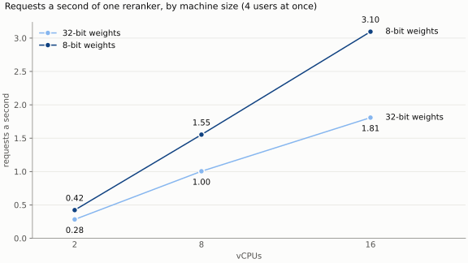
</picture>

**How to read it.** Each point is the ceiling of one reranker (its requests a second
under 4 users) on a machine of 2, 8 or 16 vCPUs. One line per way of storing the
model.

**What it shows.** With 32-bit weights: 0.28, 1.0 and 1.8 requests a second. Dividing
the vCPUs by the requests a second gives the work one request costs: 7 to 9 seconds of
one vCPU, on every machine. With 8-bit weights the same machines serve 0.42, 1.55 and
3.1: about 5 vCPU-seconds a request, one and a half times more answers.

**Why.** The model does a fixed amount of arithmetic per request, and OpenVINO spreads
it over all the CPUs of the machine. Twice the CPUs finish it in about half the time.
Numbers stored in 8 bits are cheaper to compute than numbers stored in 32.

**A caution.** 8-bit weights round the model's numbers, so its ranking can change a
little. These experiments measured its speed, not its ranking quality.

Numbers: [`data/03-bigger-machine-more-answers.csv`](data/03-bigger-machine-more-answers.csv).
Sittings: [OVMS against FastAPI on equal hardware](../experiments/2026-11-15-ovms-against-fastapi-equal-hardware/README.md)
for 2 vCPUs, [the reranker scaled up](../experiments/2026-11-15-reranker-scaled-up-8-and-16-vcpus/README.md)
for 8 and 16.

### 4. More machines or a bigger machine: about the same answers a second, not the same speed

<picture>
  <source media="(prefers-color-scheme: dark)" srcset="figures/04-scale-out-or-scale-up-dark.svg">
  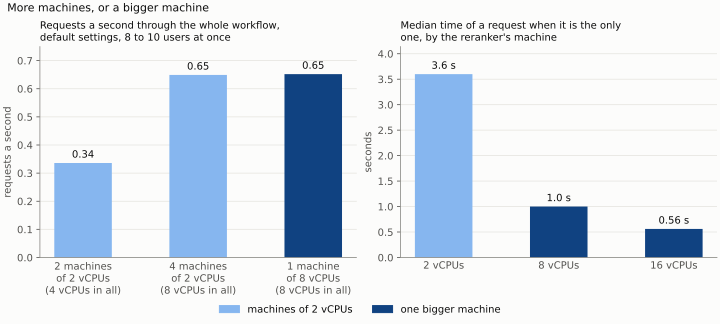
</picture>

**How to read it.** There are two ways to give the reranker more CPUs. Scaling out
(also called horizontal scaling) adds machines of the same size, each with its own copy
of the reranker, and shares the requests out between them. Scaling up (vertical
scaling) replaces the machine with a bigger one. Here the reranker has 8 vCPUs both
times, as four machines of 2 or as one machine of 8, on the same code and the same
settings. Left: the answers given each second as users are added. Right: how long each
user waits.

**What it shows.** Once full, the two serve about the same: 0.87 requests a second on
the four machines, 0.94 on the one. Before that they differ a lot. One user waits
1.3 seconds on the big machine and 4.8 seconds on the small ones. On the small machines
the wait stays at 4.8 seconds up to 4 users and only then grows. On the big machine it
grows from the second user on.

**Why.** One request is reranked by one machine. With four machines, up to four users
each have a machine to themselves: nobody queues, but nobody is served faster than a
machine of 2 vCPUs can, about 4.8 seconds. The big machine puts all 8 vCPUs on each
request (finding 7), so a request takes about a quarter of the time. Its users queue
behind each other instead, and the queue takes back what the speed gave: at 4 users the
two waits nearly meet (3.5 and 4.7 seconds), and beyond that they grow together.

**What else that sitting showed.**

- The gap once full, 7%, is no larger than the difference between machines. Three of
  the four small machines were a fifth to a quarter slower than the fourth, although
  they are the same type with the same CPU. The result says "about the same", not "the
  big machine wins".
- Waits are less even on several machines. At 8 users the slowest 1 request in 20
  waited 14 seconds on the four machines and 8.6 on the one. Requests are dealt out in
  turn, so a slower machine builds a longer queue.
- OVMS and the monolith gave the same picture. Once full: 0.65 against 0.76 requests a
  second for OVMS, 0.81 against 0.89 for the monolith. For one user: 6.2 against
  3.0 seconds, and 4.9 against 1.1.
- Scaling out needs the requests shared out evenly. In an earlier sitting a proxy rule
  that picked a machine at random for each connection lost half of the requests at
  8 users, where dealing them out in turn lost none.

**Not measured.** What happens when a machine is lost. During the set-up of this
sitting the cloud took one small machine back. With several machines that costs a
share of the capacity; with one it costs all of it.

Numbers: [`data/04-scale-out-or-scale-up.csv`](data/04-scale-out-or-scale-up.csv).
Sittings: [scale out against scale up](../experiments/2026-11-15-scale-out-against-scale-up-8-vcpus/README.md),
and [OVMS against FastAPI on equal hardware](../experiments/2026-11-15-ovms-against-fastapi-equal-hardware/README.md)
for the proxy rule.

### 5. The two model servers serve the same amount on the same weights

<picture>
  <source media="(prefers-color-scheme: dark)" srcset="figures/05-same-weights-same-throughput-dark.svg">
  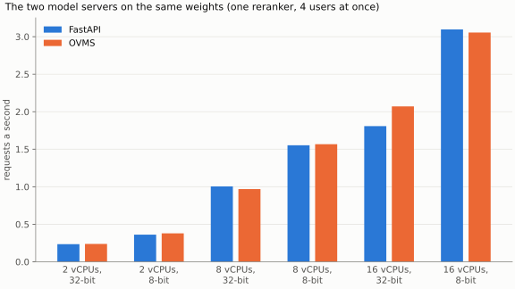
</picture>

**How to read it.** Six comparisons. In each, the two servers run the same model with
the same weights on the same machine, under 4 users.

**What it shows.** The bars of a pair are level: 0.24 against 0.24 on 2 vCPUs, 1.00
against 0.97 on 8, 3.10 against 3.05 on 16 with 8-bit weights. The one visible gap,
32-bit weights on 16 vCPUs (1.81 against 2.07), comes from the batch size of finding 8,
not from the server.

**Why.** The time goes into the model's arithmetic, and both servers hand that to the
same engine. What the server adds around it is milliseconds on requests that take
seconds.

**The trap this comparison avoided.** The first measurement gave OVMS 38 to 65% more
requests a second than FastAPI. The cause was not the server: OVMS's export had stored
the model in 8 bits, and the project's own export in 32. Compared on the same weights,
the lead disappeared. When two systems are compared, everything but the thing compared
has to be equal.

Numbers: [`data/05-same-weights-same-throughput.csv`](data/05-same-weights-same-throughput.csv).
Sittings: [OVMS against FastAPI on equal hardware](../experiments/2026-11-15-ovms-against-fastapi-equal-hardware/README.md),
[the reranker scaled up](../experiments/2026-11-15-reranker-scaled-up-8-and-16-vcpus/README.md).

### 6. Same speed, but not the same wait for everyone

<picture>
  <source media="(prefers-color-scheme: dark)" srcset="figures/06-who-waits-how-long-dark.svg">
  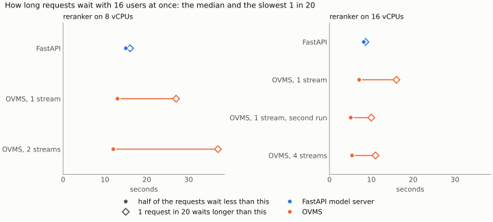
</picture>

**How to read it.** Each row is one configuration under 16 users. The first mark is
the median wait, the second the wait of the slowest 1 request in 20. A short line
means everyone waits about the same. A long line means some wait much longer than
others.

**What it shows.** With FastAPI on 8 vCPUs the typical request waits 15 seconds and
the unlucky one 16. With OVMS the typical request waits a little less, 12 to 13
seconds, and the unlucky one 27 to 37. Two runs of the same OVMS setting on 16 vCPUs
gave 16 and 10 seconds for the slowest 1 in 20: its tail also changes from run to run.

**Why.** The FastAPI model server puts requests in a queue and serves them in arrival
order. OVMS does not guarantee the order: a request that arrives later can be served
first, and an earlier one keeps waiting.

**Why it matters.** Two systems with the same requests a second can feel different. A
user notices the long wait, not the average.

Numbers: [`data/06-who-waits-how-long.csv`](data/06-who-waits-how-long.csv).
Sitting: [the reranker scaled up](../experiments/2026-11-15-reranker-scaled-up-8-and-16-vcpus/README.md).

### 7. One request already fills the machine, so running several at once gains nothing

<picture>
  <source media="(prefers-color-scheme: dark)" srcset="figures/07-one-request-fills-the-machine-dark.svg">
  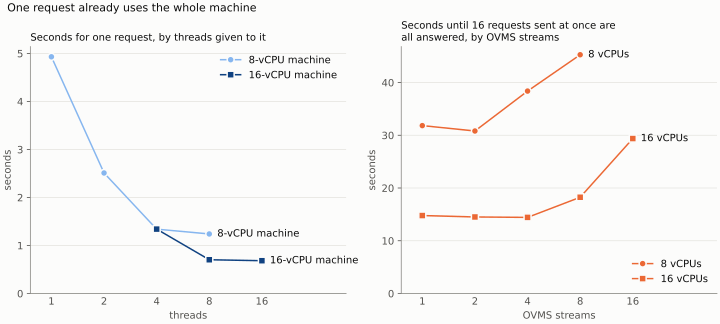
</picture>

**How to read it.** Left: how long one request takes when it is given more threads
(more CPUs working on it). Right: how long OVMS takes to answer 16 requests sent
together, when it is told to work on 1, 2, 4 or more of them at once (its streams).
Lower is better on both.

**What it shows.** Left: every doubling of the threads halves the time, up to the
number of physical cores (4 on the 8-vCPU machine, 8 on the 16-vCPU one). One request
uses the whole machine. Right: working on 2 requests at once changes nothing, and
beyond that it gets slower.

**Why.** Running two requests at once gives each one half of the CPUs, so each takes
twice as long: nothing is gained over running them one after the other. It is two
cooks sharing one kitchen. Streams pay when one request cannot use all the CPUs, for
example a small model on a machine with dozens of cores. That is not the case here.

**The cost for a lone user.** With 4 streams, a request arriving alone gets a quarter
of the machine: 0.99 seconds instead of 0.48 on 16 vCPUs.

Numbers: [`data/07-one-request-fills-the-machine.csv`](data/07-one-request-fills-the-machine.csv).
Sitting: [the reranker scaled up](../experiments/2026-11-15-reranker-scaled-up-8-and-16-vcpus/README.md).

### 8. Scoring the passages in small batches is faster when their lengths differ

<picture>
  <source media="(prefers-color-scheme: dark)" srcset="figures/08-small-batches-dark.svg">
  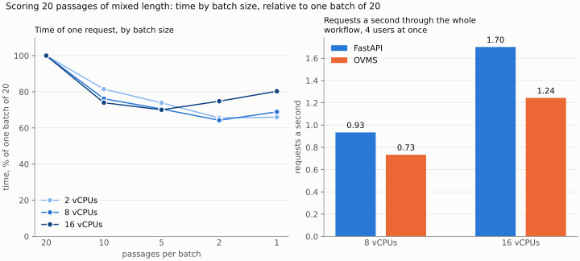
</picture>

**How to read it.** Left: the time to score the 20 passages of one request, when they
are scored 20 at a time, 10 at a time, and so on down to one by one. 100% is one batch
of 20. Right: what that does to the whole system, under 4 users.

**What it shows.** The best batch size, 2 or 5 depending on the machine, takes 64 to
70% of the time of one batch of 20. The FastAPI model server times this at start and keeps the fastest
(calibration). OVMS has no such setting: it always scores a request as one batch.
Through the whole workflow, on the real passages of the corpus, FastAPI then serves
0.93 against 0.73 requests a second on 8 vCPUs and 1.70 against 1.24 on 16.

**Why.** The passages of a batch must all have the same length, so the short ones are
padded to the length of the longest. It is like shipping books of every size in boxes
made for the largest: most boxes carry air, and the model computes on the air too.
Smaller batches waste less. With passages that all have the same length the effect
vanishes, which is why finding 5 shows no gap.

Numbers: [`data/08-small-batches.csv`](data/08-small-batches.csv).
Sittings: [OVMS against FastAPI on equal hardware](../experiments/2026-11-15-ovms-against-fastapi-equal-hardware/README.md),
[the reranker scaled up](../experiments/2026-11-15-reranker-scaled-up-8-and-16-vcpus/README.md).

### 9. Overloaded, the system loses requests, and OVMS loses them sooner

<picture>
  <source media="(prefers-color-scheme: dark)" srcset="figures/09-overload-dark.svg">
  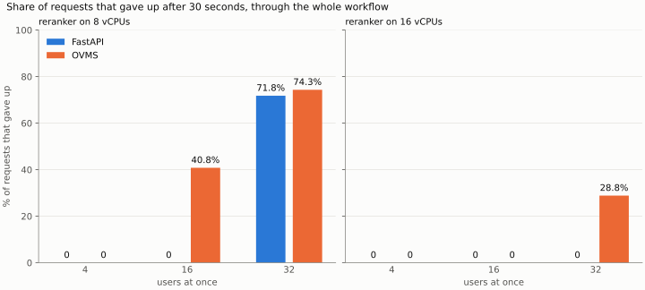
</picture>

**How to read it.** The share of requests that were not answered within 30 seconds,
through the whole workflow, as users are added. One panel per size of the reranker's
machine.

**What it shows.** With the reranker on 8 vCPUs, both servers answer everything at
4 users. At 16 users FastAPI still answers everything and OVMS loses 4 requests in 10.
At 32 users both lose about 7 in 10. On 16 vCPUs FastAPI loses nothing up to 32 users
and OVMS loses 3 in 10 there.

**Why.** The rule of finding 2 says when the wait reaches the 30-second limit: at
about 30 × requests a second users. That is 28 users at 0.93 requests a second, and
more than 50 at 1.7. FastAPI fails where the rule says. OVMS fails earlier for the two
reasons already seen: it serves less on real passages (finding 8), and some of its
requests wait far longer than the median (finding 6).

Numbers: [`data/09-overload.csv`](data/09-overload.csv).
Sitting: [the reranker scaled up](../experiments/2026-11-15-reranker-scaled-up-8-and-16-vcpus/README.md).

### 10. No topology is faster in itself: what counts is the reranker's CPUs

<picture>
  <source media="(prefers-color-scheme: dark)" srcset="figures/10-topologies-dark.svg">
  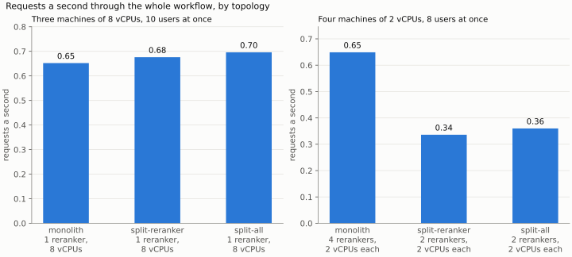
</picture>

**How to read it.** Requests a second through the whole workflow for the three
topologies, in two sittings. Under each bar: how many rerankers that layout had, and
their size. Compare the bars inside a panel: the two sittings ran different code.

**What it shows.** Left: each topology has one reranker on 8 vCPUs, and each serves
the same, 0.65 to 0.70 requests a second. Right: four small machines are shared out
differently. `monolith` puts a reranker on each of the four and serves 0.65. The split
topologies give two machines to rerankers and serve half, 0.34 and 0.36.

**Why.** Reranking is the slow part (finding 1), so the throughput follows the CPUs
given to it. In all six cases one request costs about 12 seconds of one reranker vCPU
(these runs were not calibrated; with calibration it is 8 to 9, as in finding 3).

**What the topology does change.** In `monolith` the two models share one machine: at
10 users the embed stage took 7 seconds instead of 0.07, because it waited for CPUs
the reranker was using. And only a split topology lets the reranker have a machine of
its own size, or more copies than the rest.

Numbers: [`data/10-topologies.csv`](data/10-topologies.csv).
Sittings: [the baseline of three topologies](../experiments/2026-11-14-baseline-three-topologies-fastapi-8-vcpus/README.md),
[OVMS against FastAPI on equal hardware](../experiments/2026-11-15-ovms-against-fastapi-equal-hardware/README.md).

### 11. A larger reranker changes the scale, not the findings

<picture>
  <source media="(prefers-color-scheme: dark)" srcset="figures/11-larger-model-dark.svg">
  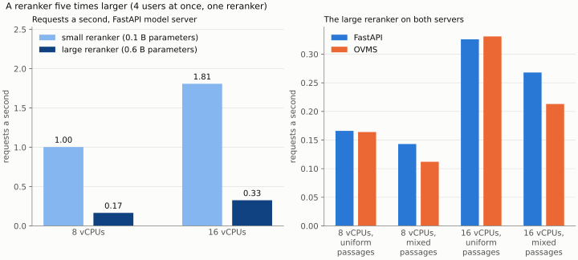
</picture>

**How to read it.** Left: the small reranker used everywhere else on this page, and
one about five times larger (0.6 billion parameters), on the same machines. Right: the
large one on the two servers, on passages of one length and of mixed lengths.

**What it shows.** The large reranker serves about six times fewer requests: 0.17
instead of 1.0 a second on 8 vCPUs. On passages of one length the two servers are
level again. On mixed lengths FastAPI is ahead by a quarter, through its batch size
again. A lone request takes 12 seconds on OVMS against 6 on FastAPI on 8 vCPUs,
because OVMS had been set to 4 streams.

**Why it was tried.** One could think that a heavier model, or a model file prepared
by OpenVINO's own team, would favour OVMS. Neither did.

Numbers: [`data/11-larger-model.csv`](data/11-larger-model.csv).
Sitting: [the reranker scaled up](../experiments/2026-11-15-reranker-scaled-up-8-and-16-vcpus/README.md).

### 12. Writing the answer: reading the prompt costs as much as writing

<picture>
  <source media="(prefers-color-scheme: dark)" srcset="figures/12-reading-and-writing-dark.svg">
  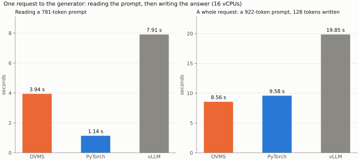
</picture>

**How to read it.** A language model answers in two steps. It first reads its prompt,
here the question and 10 passages, about 800 tokens. Then it writes the answer, one
token after another, 128 tokens at most here. Left: the time to read. Right: the time of
a whole request. Three programs ran the same model, Qwen3.5 with 2 billion parameters
and 4-bit weights, on a machine of 16 vCPUs, one request at a time: OVMS, PyTorch and
vLLM.

**What it shows.** A whole request takes 8.6 seconds on OVMS, 9.6 on PyTorch and 19.9
on vLLM. The first two end close but get there differently: PyTorch reads the prompt
in 1.1 seconds where OVMS needs 3.9, and OVMS then writes about twice as fast. Reading
is about half of OVMS's request.

**Why it matters.** A question to this system comes with 10 passages, so the prompt is
long and the answer short. A program that writes fast but reads slowly loses its lead.
No setting of OVMS changed its reading time (four were tried), so it comes from how the
model was prepared for it, not from how it is run.

The same model with its weights not rounded took 24.6 seconds under PyTorch: 4-bit
weights are worth 2.6 times here. What they cost in answer quality was not looked at.

Numbers: [`data/12-reading-and-writing.csv`](data/12-reading-and-writing.csv).
Sitting: [a generator on 16 vCPUs](../experiments/2026-11-16-generator-ovms-pytorch-vllm-16-vcpus/README.md).

### 13. With several users, answering together serves more, and one setting decides for OVMS

<picture>
  <source media="(prefers-color-scheme: dark)" srcset="figures/13-generation-under-load-dark.svg">
  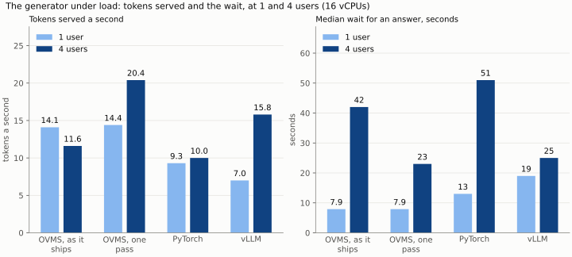
</picture>

**How to read it.** The load test of the other findings, on the whole route this time
(`/query`), with 1 user and with 4. Left: tokens of answers written each second, for
all users together; higher is better. Right: the median wait for an answer; lower is
better. "OVMS, one pass" is OVMS with one setting changed. The PyTorch program here
writes one answer at a time; OVMS and vLLM can write several together.

**What it shows.** With one user OVMS is first: 14 tokens a second and 7.9 seconds a
request, against 9 and 13 seconds for PyTorch and 7 and 19 seconds for vLLM. With 4
users the order changes. OVMS as it ships serves less than with one user, 11.6 tokens a
second, and a request waits 42 seconds. With the setting changed it serves 20.4, the
most of the four, and the wait is 23 seconds. vLLM more than doubles, to 15.8. PyTorch
stays at 10 and its users wait 51 seconds, one behind the other.

**Why it happens.** Writing the next token of four answers in one go costs less than
four separate turns, so a program that groups requests serves more. This is unlike the
reranker of finding 7, where running several requests at once gained nothing. OVMS as
it ships reads prompts in small pieces shared between the requests, which suits many
short prompts; four long prompts then wait on each other. Told to read each prompt
whole, it groups them as intended.

**Why tokens and not requests.** Capped at 128 tokens, the answers were not equally
long: always 128 on PyTorch, 114 to 122 on average on OVMS, 105 to 113 on vLLM.
Counting requests would favour the program that writes less.

**What to keep in mind.** This is a first look, on one machine that also ran the load
test. The PyTorch program is a stand-in written for the test, and it answered in 13
seconds where the same model called directly took 9.6. vLLM took 17 minutes to start
and held 20 GB of memory, against one minute and 3 GB for OVMS.

Numbers: [`data/13-generation-under-load.csv`](data/13-generation-under-load.csv).
Sitting: [a generator on 16 vCPUs](../experiments/2026-11-16-generator-ovms-pytorch-vllm-16-vcpus/README.md).

## Sizing by rule of thumb

The findings give three rules for a first estimate. They hold for this reranker, 20
passages a request and these machines: measure again for anything else.

| Question | Rule | Check against a measurement |
|---|---|---|
| How many requests a second can a reranker serve? | vCPUs ÷ 8 with 32-bit weights, vCPUs ÷ 5 with 8-bit weights | 16 vCPUs: 2.0 and 3.2 by the rule, 1.8 and 3.1 measured |
| How long will users wait? | users ÷ requests a second, minus the pause | 16 users at 1.8 a second: 8.3 s by the rule, 8.2 s measured |
| How many users fit under a wait of W seconds? | (W + pause) × requests a second | 5 seconds on 16 vCPUs: 10 users by the rule; measured 3.9 s at 8 users and 8.2 s at 16 |

The "users" of these rules are the simulated ones, who ask again within a second.
People read the answer first. Ten such users stand for many more people.

## What to take away

- Give the reranker the CPUs. It is where the time goes, and its throughput grows with
  them.
- To serve more users, add reranker CPUs either way: more machines or a bigger one. To
  make each answer faster, take a bigger machine: more machines do not shorten a
  request.
- Decide the weight format first. 8-bit weights give one and a half times the
  throughput on either server, and their ranking quality has to be checked before
  they are adopted.
- For these rerankers the FastAPI model server is the better choice on machines of up
  to 8 cores: the same throughput as OVMS, more on real passages, a fair queue, and
  fewer lost requests under overload. OVMS remains worth it for what it has and
  FastAPI has not: model versions, metrics, changes of configuration while running.
- Let the program calibrate itself. The batch size it finds is worth about a third of
  the time of a request.
- Choose the topology for how it lets machines be sized and shared, not for speed.
- For the generate stage on a CPU, count tokens served a second, not requests, and cap
  every answer alike: programs do not write answers of the same length.
- Of the three programs tried for it, OVMS was the fastest, once told to read each
  prompt in one pass. Try that setting before judging it under several users.
- Look at a program's start and its memory as well as its speed: vLLM needed 17
  minutes and 20 GB where OVMS needed one minute and 3 GB.

## What these experiments do not say

- Each point is one run of 2 minutes. Differences of a few percent are noise.
- The machines are whole virtual machines on a cloud emulation of the target platform,
  not that platform. There a program gets a share of a machine.
- One corpus (French, 1,592 passages), two rerankers, 20 passages a request, machines
  of up to 16 vCPUs. Nothing here says what happens beyond.
- The last stage, writing the answer, was measured once, by hand on one machine, with
  one small language model and runs of 11 to 30 requests (findings 12 and 13). Whether
  its answers are good was not looked at.
- The ranking quality of 8-bit weights was not measured.
- Sittings ran on different code and machines. Figures compare inside a sitting, and
  the charts say when they combine two.
- More machines were compared with a bigger machine in one sitting, at 8 vCPUs in
  total, with small machines that were not equally fast.

## Where everything is

| What | Where |
|---|---|
| Every run, its settings and its statistics | [`experiments/`](../experiments/README.md), one folder per sitting |
| The technical comparison of the two model servers, for the reranker and the embedder | [`docs/model-servers.md`](../docs/model-servers.md) |
| The table behind each chart | [`data/`](data/), one CSV file per chart, each row with the id of its experiment |
| The charts | [`figures/`](figures/), each in a light and a dark version |
| The program that draws them | `src/experiment_charts/`, run by `make experiment-charts` |

To redraw everything after a new sitting is registered:

```bash
make experiment-charts
```

A test fails when a table in `data/` no longer matches the registry.
